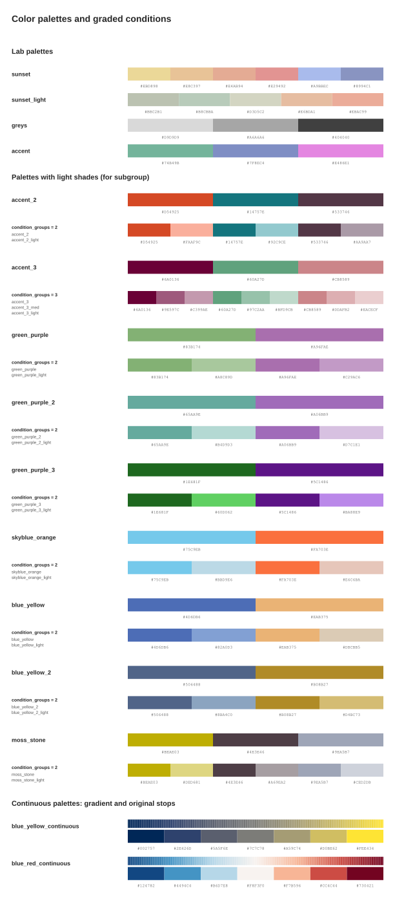
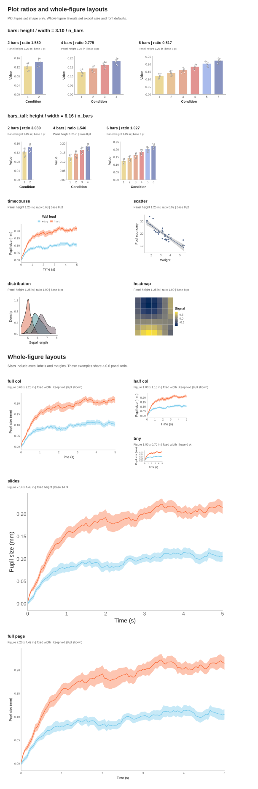

# kiyonagalabviz

A ggplot2 theme, colour palettes, plot helpers and figure export in the
Kiyonaga Lab style.

## Installation

```r
# Requires R >= 4.1.0 and ggplot2 >= 4.0.0
install.packages("remotes")
remotes::install_github("vsc04/kiyonagalabviz")
install.packages("svglite")  # only needed to save .svg files
```

## Quick start

```r
library(kiyonagalabviz)
library(ggplot2)

sim <- simulate_lab_data()  # example pupil timecourses and accuracy

# 1) Timecourse, with the analysis window shaded
p <- plot_timecourse(sim$timecourse, "time", "pupil", group = "load",
                     palette = "skyblue_orange", window = c(3, 5)) +
  labs(x = "Time (s)", y = "Pupil size (mm)")
nice_save("timecourse.pdf", p, layout = "half col")

# 2) Bars: mean pupil size over 3-5 s, one row per subject and load
bars <- average_window(sim$timecourse, window = c(3, 5))
plot_bars(bars, "load", "pupil", group = "load", palette = "blue_yellow")

# 3) Scatter: pupil vs accuracy, with a linear fit per load
d <- merge(bars, sim$behavior, by = c("subject", "load"))
plot_scatter(d, "pupil", "accuracy", group = "load", fit = TRUE)
```

`average_window()` defaults (`value = "pupil"`, `time = "time"`,
`by = c("subject", "load")`) match the simulated data; set them for your own.


## Core concepts

Column names are given as strings. Every helper returns a ggplot, so you can
add layers, labels and scales with `+`.

| Argument | Controls | Examples |
|---|---|---|
| `group` | Colour | `group = "load"` |
| `subgroup` | Dark / light shade of each group colour | `subgroup = "session"` |
| `palette` | Colour set | `"accent"`, `"skyblue_orange"` |
| `error` | Error bars or ribbons | `"se"`, `"sd"`, `"ci"` (95%), `"none"` |
| `preset` | Panel shape (height / width) | `"bars"`, `"timecourse"`, `"scatter"` |
| `layout` (in `nice_save()`) | Exported figure size | `"half col"`, `"full col"`, `"slides"` |
| `point_preset` | Individual dots | `"grey_filled"`, `"colour_outlined"` |
| `legend` | Legend placement | `"inside"` (default), `"separate"`, `"none"` |

## Plot helpers

| Function | Draws | Default `preset` |
|---|---|---|
| `plot_timecourse()` | Mean lines with error ribbons; optional shaded `window` | `timecourse` |
| `plot_lines()` | Mean lines; optional `rolling_window` and `subject` averaging | `timecourse` |
| `plot_bars()` | Mean bars, error bars and individual dots | `bars` |
| `plot_means()` | Mean points, error bars; optional dots and `mean_line` | `scatter` |
| `plot_boxplots()` | Median, IQR, 1.5 IQR whiskers and individual dots | `distribution` |
| `plot_paired()` | Each subject's means connected across conditions | `scatter` |
| `plot_scatter()` | One point per row; optional linear fit per group (`fit = TRUE`) | `scatter` |
| `plot_predictions()` | Fitted lines with confidence bands and binned means | `scatter` |
| `plot_histogram()` | Histogram; optional density curve | `distribution` |
| `plot_density()` | Kernel density | `distribution` |
| `plot_heatmap()` | Borderless tiles with a continuous colour bar | `heatmap` |

- `error` defaults to `"se"`; `plot_predictions()` uses `"ci"`, and
  `plot_timecourse()` has no `"none"` option.
- `palette` defaults to `"accent"`; `plot_bars()` uses `"greys"`,
  `plot_heatmap()` uses `"blue_yellow_continuous"`.
- Without `group`, plots are drawn in grey and `palette` is ignored
  (except heatmaps).

```r
plot_means(bars, "load", "pupil", group = "load", show_points = TRUE,
           mean_line = TRUE)
plot_paired(bars, "load", "pupil", subject = "subject")
plot_lines(sim$timecourse, "time", "pupil", subject = "subject",
           group = "load", rolling_window = 0.1)
plot_predictions(mtcars, "wt", "mpg", group = "am", bins = 5)

# Heatmap: one row per x/y cell; group / subgroup become facet rows / columns
map <- expand.grid(x = -5:5, y = -5:5)
map$value <- with(map, x * exp(-(x^2 + y^2) / 8))
plot_heatmap(map, "x", "y", "value", palette = "blue_red_continuous",
             midpoint = 0)
```


## Colours



- **Discrete:** `sunset`, `sunset_light`, `greys`, `accent`.
- **With light shades** (for `group` + `subgroup`): `accent_2`, `accent_3`,
  `green_purple`, `green_purple_2`, `green_purple_3`, `skyblue_orange`,
  `blue_yellow`, `blue_yellow_2`, `moss_stone`. Each has a `_light` variant;
  `accent_3` also has `_med`.
- **Continuous:** `blue_yellow_continuous` (sequential),
  `blue_red_continuous` (signed; use with `midpoint = 0`).

`group` picks the colour and `subgroup` the shade: the first subgroup level is
dark, the second light. This needs a palette with light shades and two
subgroup levels (three for `accent_3`).

```r
d2 <- expand.grid(task = c("A", "B"), session = c("first", "second"),
                  subject = 1:4)
d2$value <- seq_len(nrow(d2))
plot_bars(d2, "task", "value", group = "task", subgroup = "session",
          palette = "blue_yellow_2")
```

The theme and scales work with any ggplot:

```r
ggplot(mtcars, aes(wt, mpg, colour = factor(cyl))) +
  geom_point() +
  scale_colour_kiyonaga("accent") +   # discrete = FALSE for continuous
  theme_kiyonaga(preset = "scatter")
```

`preview_kiyonaga_palettes()` shows all palettes in R.

## Figure size and export



| `preset` | Panel height / width |
|---|---|
| `bars` | 3.10 / number of bars |
| `bars_tall` | 6.16 / number of bars |
| `timecourse` | 0.68 |
| `scatter` | 0.92 |
| `distribution`, `heatmap` | 1 |

| `layout` | Fixed size (inches) | Base text |
|---|---|---|
| `"full col"` (default) | 3.6 wide | Plot's own (8 pt) |
| `"half col"` | 1.8 wide | Plot's own (8 pt) |
| `"full page"` | 7.2 wide | Plot's own (8 pt) |
| `"tiny"` | 1.0 wide | 6 pt |
| `"slides"` | 4.4 high | 14 pt |

- The other dimension follows from the panel ratio.
- Tick and legend labels are 85% of the base text size.
- `font_size` overrides the text size; `custom = c(width, height)` sets the
  size in inches.
- Point sizes and line widths are not rescaled between layouts.
- `.pdf` is the preferred format; `.svg` needs svglite.

## Legends

`legend = "separate"` hides the legend so it can be saved on its own:

```r
p <- plot_means(bars, "load", "pupil", group = "load", legend = "separate")
nice_save("means.svg", p, layout = "half col")
nice_save("means_legend.svg", plot_legend(p))
```

## Individual dots and ticks

| `point_preset` | Appearance | Size | Alpha |
|---|---|---|---|
| `"grey_filled"` (bars, means, boxplots default) | Solid grey | 1 | 0.6 |
| `"colour_outlined"` (scatter default) | Group colour, grey outline | 1.5 | 0.8 |
| `"colour_filled"` | Solid group colour | 1 | 0.6 |
| `"grey_small"` | Small, faint grey | 0.5 | 0.4 |
| `"colour_small"` | Small, faint group colour | 0.5 | 0.4 |
| `"charite"` | White fill, dark grey outline | 1 | 0.8 |


`point_style` overrides single settings (`size`, `shape`, `fill`, `colour`,
`alpha`, `stroke`). Ticks are off by default:

```r
plot_bars(bars, "load", "pupil", point_style = list(size = 1.5))
plot_bars(bars, "load", "pupil", ticks = "inside", tick_length = 2)
```

## Statistical notes

- Error bars and ribbons are computed across input rows. Average to one row
  per subject and condition first (e.g. with `average_window()`), or use
  `subject` in `plot_lines()` and `plot_paired()`.
- Fits in `plot_scatter()` and `plot_predictions()` are made separately per
  group, treat rows as independent and do not test interactions.
- For intervals from your own model (e.g. a mixed model), pass a data frame
  of predictions with `lower` and `upper` columns to
  `plot_predictions(predictions = ...)`.

## Other functions

- `kiyonaga_colors`, `kiyonaga_palettes`, `kiyonaga_palette_groups`,
  `make_kiyonaga_palette()`: raw colours and palette functions.
- `kiyonaga_plot_presets`, `kiyonaga_point_presets`: all preset settings.
- `mean_sd()`, `mean_ci()`: for `stat_summary(fun.data = ...)`.
- `simulate_lab_data()`, `average_window()`: example data and window
  averaging.

See each function's help page (e.g. `?plot_predictions`) for all arguments.

## Development

```r
# install.packages("devtools")
devtools::document()
devtools::test()
devtools::check()
```

Package structure adapted from [`charite`](https://github.com/johannesjuliusm/charite)
by Johannes Julius Mohn (MIT licence).
