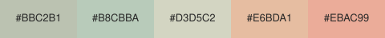
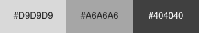
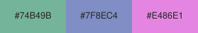
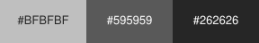

# kiyonagalab
A small R package with the Kiyonaga Lab figure style for `ggplot2`: a theme
color palettes and font sizes,  and publication-ready export.


## To-do 
- add switch for axes ticks INSIDE or OUTSIDE or OFF (AK style)
- add other plot format (e.g., heatmaps)
- format bar plots (narrower bars, bigger subject dots)
- linewidth needs to be consistent and visible
- errorbars need to be consistent
- 


## Installation

```r
# install.packages("devtools")
devtools::install_github("vsc04/kiyonagalabviz")
```

Requires `ggplot2 >= 4.0.0`.

## Quick start

```r
library(kiyonagalabviz)
library(ggplot2)

sim <- simulate_lab_data()
# sim$timecourse: subject x load (easy, hard) x time (0-5 s, 20 Hz), outcome = pupil size (mm, baseline-corrected)
# sim$behavior:   subject x load, outcome = accuracy (proportion correct)

# Timecourse: mean +/- SE ribbons (alpha 0.4), analysis window 3-5 s shaded
plot_timecourse(sim$timecourse, time = "time", y = "pupil",
                group = "load", window = c(3, 5)) +
  labs(x = "Time (s)", y = "Pupil size (mm)", colour = "Load", fill = "Load")

# Average the pupil over 3-5 s: one value per subject and load
d <- merge(average_window(sim$timecourse, window = c(3, 5)), sim$behavior)
# d: subject x load, pupil = mean pupil size 3-5 s, accuracy

# Bars = condition means, grey error bars (SE), individual data points on top
p_bars <- plot_bars(d, x = "load", y = "pupil", group = "load") +
  labs(x = "WM load", y = "Pupil size 3-5 s (mm)") +
  theme(legend.position = "none")
p_bars

# Scatter: pupil vs accuracy
ggplot(d, aes(pupil, accuracy, colour = load)) +
  geom_point(size = 1) +
  geom_smooth(method = "lm", formula = y ~ x, se = FALSE, linewidth = 0.5) +
  scale_colour_kiyonaga("accent") +
  labs(x = "Pupil size 3-5 s (mm)", y = "Accuracy", colour = "Load") +
  theme_kiyonaga()

# Save (keeps the panel aspect ratio)
nice_save("pupil_bars.pdf", plot = p_bars, layout = "half col")    # paper: 8 pt text
nice_save("pupil_bars.png", plot = p_bars, layout = "slides")      # slides: 14 pt text
nice_save("pupil_bars_talk.png", plot = p_bars, layout = "slides",
          font_size = 18)                                          # any text size
nice_save("pupil_bars_tiny.pdf", plot = p_bars, layout = "tiny")   # inset: 6 pt text
```

## What's inside

| Function | Purpose |
|---|---|
| `theme_kiyonaga()` | AK Style: 8 pt titles, ~7 pt tick/legend labels, light grey axes, no ticks, legend on top with bold title |
| `plot_bars()` | Mean bars + error bars (`"se"`, `"sd"`, `"ci"`, `"none"`) + optional jittered individual points (`show_points`) |
| `scale_fill_kiyonaga()`, `scale_colour_kiyonaga()` | Discrete or continuous scales from a lab palette |
| `kiyonaga_colors`, `kiyonaga_palettes` | Named hex colours and palettes |
| `make_kiyonaga_palette()` | Palette function `n -> colours`; uses the exact lab colours when `n` fits |
| `preview_kiyonaga_palettes()` | Show all palettes |
| `mean_sd()`, `mean_ci()` | Summary functions for `stat_summary(fun.data = ...)` |
| `nice_save()` | Export at `"full col"`, `"half col"`, `"tiny"`, `"full page"`, `"slides"` sizes |
| `simulate_lab_data()` | Example data: pupil timecourse (subject x load x time, 0-5 s) and accuracy (subject x load) |
| `average_window()` | Average a timecourse within a time window (default 3-5 s), per subject and condition |
| `plot_timecourse()` | Mean +/- SE ribbons (alpha 0.4) over time per condition, analysis window shaded |


## Palettes

**`sunset`** ("About the lab" logo)


**`sunset_light`** ("Papers" artwork)



**`greys`** (Fgure greys; two groups give light and dark bars)



**`accent`** 



**Theme greys** (axis lines, tick and legend labels, text; not a palette)



Run `preview_kiyonaga_palettes()` in R to see all palettes, or
`preview_kiyonaga_palettes("continuous")` for the gradients.


## Development

Package structure adapted from [`charite`](https://github.com/johannesjuliusm/charite)
by Johannes Julius Mohn (MIT licence).

```r
devtools::document()   # generate man/ pages from the roxygen comments
devtools::test()
devtools::check()
```
