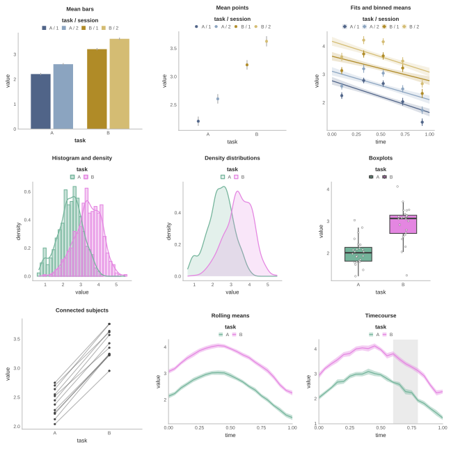
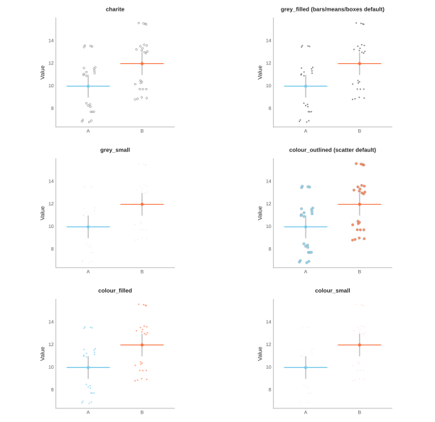
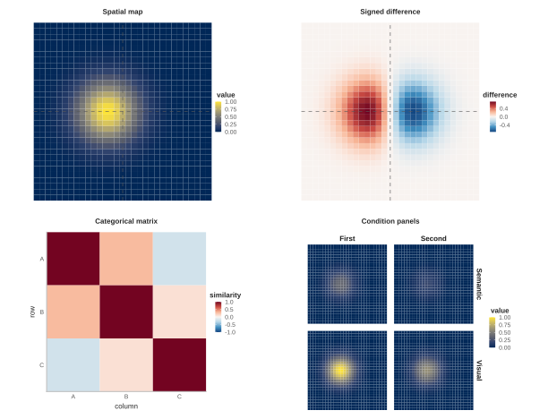

# kiyonagalabviz

A ggplot2 theme, colour palettes, plotting helpers and figure export in the
Kiyonaga Lab style. Requires R >= 4.1.0 and ggplot2 >= 4.0.0.

## Installation

```r
# install.packages("devtools")
devtools::install_github("vsc04/kiyonagalabviz")
```

## Quick start

```r
library(kiyonagalabviz)
library(ggplot2)

sim <- simulate_lab_data()
p <- plot_timecourse(sim$timecourse, "time", "pupil", group = "load",
                     palette = "skyblue_orange") +
  labs(x = "Time (s)", y = "Pupil size (mm)")
nice_save("timecourse.svg", p, layout = "half col")

bars <- average_window(sim$timecourse, window = c(3, 5))
plot_bars(bars, "load", "pupil", palette = "blue_yellow")

# Pupil versus accuracy: one row per subject and load
# Pupil values are averaged over 3-5 s; accuracy is a proportion correct.
d <- merge(bars, sim$behavior, by = c("subject", "load"))
ggplot(d, aes(pupil, accuracy, colour = load)) +
  geom_point(size = 1) +
  geom_smooth(method = "lm", formula = y ~ x, se = FALSE, linewidth = 0.5) +
  scale_colour_kiyonaga("accent") +
  labs(x = "Pupil size 3-5 s (mm)", y = "Accuracy", colour = "Load") +
  theme_kiyonaga(preset = "scatter")
```

`plot_bars()` draws means, error bars and optional individual points.
`plot_timecourse()` draws means and uncertainty ribbons. Both accept `group` for primary colours, `subgroup` for secondary shades,
a palette name and a plot ratio `preset`. The theme and scales also work with any ggplot.

## Plot helpers

All helpers use `theme_kiyonaga()` and support `palette`, `preset`, and
`legend`. Column names are supplied as strings. `group` and `subgroup` select
colours and shades in the other helpers; heatmaps use them for condition panels.

| Helper | Displays |
|---|---|
| `plot_bars()` | Mean bars, uncertainty intervals and optional individual points |
| `plot_means()` | Mean points and uncertainty intervals, without bars |
| `plot_predictions()` | Fitted lines, confidence bands and binned means; grouped fits visualize interactions |
| `plot_histogram()` | Histogram with an optional density curve |
| `plot_density()` | Kernel density distributions |
| `plot_boxplots()` | Median, interquartile range, whiskers and optional individual points |
| `plot_paired()` | Connected subject means across ordered conditions |
| `plot_lines()` | Mean lines with optional rolling averages and uncertainty ribbons |
| `plot_timecourse()` | Timecourse means and ribbons with an optional shaded analysis window |
| `plot_heatmap()` | Borderless numeric grids or categorical matrices with a continuous colour bar |



Defaults use 0.6 mm mean/fitted lines, 0.5 mm intervals, box outlines and subject
connections, and 1.5 mm mean points. These are adjustable through `linewidth`
and `point_size` where applicable. Plot-type ratios share the standard lab
fonts; distribution plots use `"distribution"`, means/predictions/paired plots
use `"scatter"`, and line plots use `"timecourse"`.

```r
plot_means(bars, "load", "pupil", group = "load", error = "ci")
plot_histogram(mtcars, "mpg", bins = 10, density = TRUE)
plot_density(mtcars, "mpg", group = "am")
plot_boxplots(mtcars, "cyl", "mpg", group = "am")
plot_paired(bars, "load", "pupil", subject = "subject")

# Linear fits use all rows; binning affects only the displayed points
plot_predictions(mtcars, "wt", "mpg", group = "am", bins = 5,
                 bin_method = "quantile")

# Smooth within each subject before computing the group mean and uncertainty
plot_lines(sim$timecourse, "time", "pupil", subject = "subject",
           group = "load", rolling_window = 0.1)
```

`plot_predictions()` defaults to linear fits and five equal-width bins, with
95% confidence bands and t-based intervals for bin means. Set `error` to
`"se"`, `"sd"`, `"ci"` (default), or `"none"` to choose the binned-point error
bars. `"none"` keeps the points without error bars. The fitted confidence band
is controlled independently by `confidence`; `conf` sets its confidence level
and the binned interval level when `error = "ci"`.

```r
plot_predictions(mtcars, "wt", "mpg", error = "se")
plot_predictions(mtcars, "wt", "mpg", error = "none", confidence = TRUE)
```

Use `bin_method = "quantile"` for equal-count bins, `bins = NULL` to hide the points,
or `method`, `formula`, and `method_args` to choose a different fit. Each group
is fitted separately; this does not test an interaction. For predictions from
a joint, mixed-effects or other fitted model, pass `predictions`: a data frame
with the same x, y, group and subgroup column names, plus `lower` and `upper`
confidence limits. Supplied predictions are drawn unchanged. Binned intervals
summarize input rows and do not account for repeated measures.

`plot_lines()` takes a centred `rolling_window` in x-axis units and uses
available values at the edges. With `subject`, repeated rows are first averaged
within subject and x, and uncertainty is calculated across subjects. Without
`subject`, rolling requires one row per x and condition. `error = "none"`
hides ribbons. `plot_paired()` also averages repeated observations within each
subject and condition before connecting points in x-factor order.

### Axis ticks and subject points

Ticks default to off (AK style). Use `ticks = "inside"` or `"outside"` in the
theme or any plot helper; `tick_length` sets their length in points. Existing
`ticks = FALSE` / `TRUE` calls still mean off / outside.

```r
theme_kiyonaga(ticks = "inside", tick_length = 2)
plot_bars(bars, "load", "pupil", ticks = "outside")
```

Subject points in bars, mean plots and boxplots share the same `point_preset`
options. The default preserves the original 1 mm white-filled circles.
`point_style = list(size = 1.5)` overrides the preset size; `bar_width` controls
bar width independently.

| `point_preset` | Individual-dot appearance | Size | Alpha |
|---|---|---|---|
| `"default"` | White circles, dark grey outlines | 1 mm | 0.8 |
| `"grey_filled"` | Solid grey circles; ocular paper Fig. 3D | 1 mm | 0.6 |
| `"colour_outlined"` | Group-coloured circles, grey outlines; sensorimotor paper Fig. 1D | 1.5 mm | 0.8 |
| `"grey_small"` | Small faint grey circles; pupil/task paper Fig. 1D-F | 0.5 mm | 0.4 |

These paper-based styles are visual approximations. Original point sizes and
alpha values cannot be recovered exactly from the PDFs. Presets affect
individual dots only. `point_style` overrides any preset field.



```r
plot_means(bars, "load", "pupil", group = "load", show_points = TRUE,
           point_preset = "colour_outlined", mean_line = TRUE)
plot_bars(bars, "load", "pupil", point_preset = "grey_filled",
          point_style = list(size = 1.5))
plot_boxplots(bars, "load", "pupil", point_preset = "grey_small")
```

```r
plot_bars(bars, "load", "pupil", show_points = TRUE,
          point_style = list(size = 1.5))
plot_means(bars, "load", "pupil", show_points = TRUE,
           point_style = list(size = 1.5), mean_line = TRUE)
plot_boxplots(bars, "load", "pupil", show_points = TRUE,
              point_style = list(size = 1.5))
```

In `plot_means()`, `mean_line = TRUE` draws a horizontal line through the mean
that extends beyond the jittered dots. `mean_line_width` controls its width;
by default it follows `jitter_width`. The mean point remains visible.

Individual dots default to shape 21 (white-filled circles with grey outlines),
`alpha = 0.8` and `stroke = 0.3`. These are shared defaults rather than exact
paper-specific marker settings. Use `point_style` to adjust them:

```r
# Solid grey circles
plot_means(bars, "load", "pupil", show_points = TRUE, mean_line = TRUE,
           point_style = list(size = 1.5, shape = 16, colour = "grey50", alpha = 0.6))

# Group-coloured fills with grey outlines
plot_bars(bars, "load", "pupil", group = "load",
          point_style = list(size = 1.5, fill = NULL, alpha = 0.6))
```

### Heatmaps



Supply one row per x/y cell and condition, with a numeric value column.
`plot_heatmap()` uses borderless tiles, square panels and a colour bar on the
right. Numeric coordinates are tile centres; factor levels control categorical
axis order. Values are drawn without smoothing or normalization. Aggregate
repeated observations before plotting.

```r
map <- expand.grid(x = -5:5, y = -5:5)
map$value <- with(map, exp(-(x^2 + y^2) / 8))
plot_heatmap(map, "x", "y", "value", show_axes = FALSE)

map$difference <- with(map, x * exp(-(x^2 + y^2) / 8))
plot_heatmap(map, "x", "y", "difference",
             palette = "blue_red_continuous", midpoint = 0)
```

Use `blue_yellow_continuous` for sequential values and `blue_red_continuous`
for signed maps. `midpoint = 0` centres the colour range on zero; `limits`
sets an explicit shared range. Missing values are transparent by default.
`reverse_y = TRUE` puts the first matrix row at the top or reverses numeric
screen coordinates. Set `show_axes = FALSE` for an unlabelled spatial map;
`reference = c(0, 0)` adds dashed lines at the origin. `group` creates facet rows and `subgroup` facet columns, all sharing one colour
scale. `legend = "separate"` works with `plot_legend()` as below.

### Legends

Every plotting helper accepts `legend = "inside"` (default), `"separate"`, or
`"none"`. `"inside"` keeps the legend at the theme's position, normally above
the panel. `"separate"` returns a regular ggplot with its legend hidden; extract
and save the legend explicitly:

```r
p <- plot_means(bars, "load", "pupil", group = "load", legend = "separate")
nice_save("means.svg", p, layout = "half col")
nice_save("means_legend.svg", plot_legend(p))
```

Separate legends are sized to their contents. Set fonts on the source plot
before extracting the legend, or pass `custom = c(width, height)` in inches to
control its export canvas. `plot_legend()` also works with other ggplots.

## Palettes


### Lab palettes

- `sunset`: six colours from yellow through warm tones to periwinkle.
- `sunset_light`: five pastel colours from sage to salmon.
- `greys`: light, medium and dark grey; requesting two colours selects light and dark.
- `accent`: green, blue and magenta.

### 2 condition palettes

Use a main palette for primary categories. To distinguish a second condition,
use the darker and lighter shades of each colour with `condition_groups`.
All built-in shades are fully opaque.

| Main palette | Colour order | `condition_groups` | Additional shade palettes |
|---|---|---|---|
| `accent_2` | Coral, teal, purple | 2 | `accent_2_light` |
| `accent_3` | Burgundy, green, rose | 3 | `accent_3_med`, `accent_3_light` |
| `green_purple` | Green, purple | 2 | `green_purple_light` |
| `green_purple_2` | Teal, purple | 2 | `green_purple_2_light` |
| `green_purple_3` | Green, purple | 2 | `green_purple_3_light` |
| `skyblue_orange` | Sky blue, orange | 2 | `skyblue_orange_light` |
| `blue_yellow` | Blue, yellow | 2 | `blue_yellow_light` |
| `blue_yellow_2` | Muted blue, gold | 2 | `blue_yellow_2_light` |

`condition_groups = NULL` uses the named palette alone. With grouping, colours
are ordered by primary category, then dark to light (`accent_3` uses dark,
medium, light). Set factor levels or scale `limits` in that order. In the plot
helpers, pass separate columns as `group` and `subgroup`; the shade count and
combination order are inferred. Existing factor levels determine the order;
other columns are sorted alphabetically or numerically. Use a palette from
the table above, with two subgroup levels (three for `accent_3`).

```r
d <- expand.grid(task = c("A", "B"), session = c("first", "second"),
                 time = 1:3, subject = 1:4)
d$value <- seq_len(nrow(d))
plot_bars(d, "task", "value", group = "task", subgroup = "session",
          palette = "blue_yellow_2")
plot_timecourse(d, "time", "value", group = "task", subgroup = "session",
                palette = "blue_yellow_2")
```

Set subgroup factor levels in the desired dark-to-light order. Both helpers
summarize each group/subgroup combination separately and label the legend with
both values. Missing combinations retain their assigned colours and remain in
the legend. Without `subgroup`, `group` uses the main palette alone.

```r
# Four colours: blue dark/light, then yellow dark/light
make_kiyonaga_palette("blue_yellow_2", condition_groups = 2)(4)

scale_colour_kiyonaga(
  "blue_yellow_2", condition_groups = 2,
  limits = c("blue_dark", "blue_light", "yellow_dark", "yellow_light")
)

# Nine colours: three primary colours, each with three shades
make_kiyonaga_palette("accent_3", condition_groups = 3)(9)

# Shade palettes can also be used individually
scale_fill_kiyonaga("skyblue_orange_light")
```

For palette functions and scales, `condition_groups` still specifies the shade
count explicitly. The requested colour count is the total number of
combinations. It must be a multiple of `condition_groups` and cannot exceed the recorded combinations.
`reverse = TRUE` reverses primary colours while keeping their shade order.

### Continuous palettes

- `blue_yellow_continuous`: navy through grey and olive to yellow.
- `blue_red_continuous`: blue through a pale neutral centre to red.

```r
ggplot(mtcars, aes(wt, mpg, colour = hp)) +
  geom_point() +
  scale_colour_kiyonaga("blue_red_continuous", discrete = FALSE) +
  theme_kiyonaga(preset = "scatter")
```

Use `preview_kiyonaga_palettes()` to view palettes in R. Raw colour vectors are
in `kiyonaga_palettes`; shade combinations are in `kiyonaga_palette_groups`.

## Panel ratios and figure sizes

Choose a plot-type `preset` for panel shape and a `nice_save()` layout for
whole-figure size. Ratios are panel **height / width**; they do not set font
sizes or physical dimensions.


| Plot ratio preset | Panel height / width |
|---|---|
| `bars` | `3.10 / n_bars` |
| `bars_tall` | `6.16 / n_bars` |
| `timecourse` | 0.68 |
| `scatter` | 0.92 |
| `distribution` | 1.00 |
| `heatmap` | 1.00 |

`plot_bars()` defaults to `"bars"` and counts bars automatically;
`plot_timecourse()` defaults to `"timecourse"`. Bar ratios decrease as bar
count increases (for two bars: 1.55 or 3.08). Faceted bar plots use the largest
bar count per panel when exported. Supply `n_bars` to override counting, or
`aspect_ratio` to set the ratio directly. The SVG compares ratios at a common
panel height.

| Export layout | Fixed dimension (inches) | Base text size |
|---|---|---|
| `"full col"` | Width 3.6 | Keep plot's sizes |
| `"half col"` | Width 1.8 | Keep plot's sizes |
| `"tiny"` | Width 1.0 | 6 pt |
| `"full page"` | Width 7.2 | Keep plot's sizes |
| `"slides"` | Height 4.4 | 14 pt |

For width-based layouts, space remaining after axes, legends, margins and
facet spacing determines panel width; the ratio determines panel height.
`"slides"` fixes figure height and derives width. The standard theme uses
8 pt base text, with tick and legend labels at 85% of that size. Override with
`font_size`; plot-type presets share the same typography.

```r
# Automatic bar count with the taller ratio
p_bars <- plot_bars(bars, "load", "pupil", preset = "bars_tall")
nice_save("bars.svg", p_bars, layout = "half col")
nice_save("bars_slides.svg", p_bars, layout = "slides")

# Apply a ratio to any ggplot
p_scatter <- ggplot(mtcars, aes(wt, mpg)) +
  geom_point() + theme_kiyonaga(preset = "scatter")
nice_save("scatter.svg", p_scatter, layout = "full col")

# With the theme directly, supply the bar count
# theme_kiyonaga(preset = "bars", n_bars = 4)
```

`nice_save(preset = "scatter", ...)` can also apply a ratio at export.
`custom = c(width, height)` overrides total figure dimensions in inches.
Inspect all settings in `kiyonaga_plot_presets`. The scatter and distribution
presets provide ratios for ggplots you create yourself. `plot_heatmap()` uses
the `"heatmap"` ratio by default.

## Development

```r
devtools::document()
devtools::test()
devtools::check()
```

Package structure adapted from [`charite`](https://github.com/johannesjuliusm/charite)
by Johannes Julius Mohn (MIT licence).
