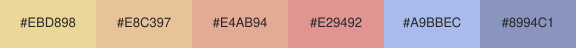

# kiyonagalab
A small R package with the Kiyonaga Lab figure style for `ggplot2`: a theme
color palettes and font sizes,  and publication-ready export.


## To-do
Add 
- switch for axes ticks inside or outside or OFF (AK style)
- other plot format (e.g., heatmaps)
-  format bar plots (narrower bars, bigger subject dots)

## Installation

```r
# install.packages("devtools")
devtools::install_github("vsc04/kiyonagalabviz")
```

Requires `ggplot2 >= 4.0.0`.

## Quick start

```r
library(kiyonagalabviz)
library(ggplot2)

d <- simulate_lab_data()   # subject x load , outcome = pupil size and 

# Bars = condition means, grey error bars (SE), individual data points on top
plot_bars(d, x = "load", y = "beta", group = "difficulty") +
  labs(x = "WM load", y = "Left Parietal β", fill = "Visual search difficulty")

# Without points, 95% CI, sunset colours, larger font for slides
plot_bars(d, "load", "beta", group = "difficulty",
          show_points = FALSE, error = "ci", palette = "sunset", font_size = 12)

# Use the theme and scales in any ggplot
ggplot(mtcars, aes(wt, mpg, colour = factor(cyl))) +
  geom_point() +
  scale_colour_kiyonaga("papers") +
  theme_kiyonaga()

# Save at journal column width (keeps the panel aspect ratio)
nice_save("figure_2.pdf", layout = "half col")
```

## What's inside

| Function | Purpose |
|---|---|
| `theme_kiyonaga()` | AK Style: 8 pt titles, ~7 pt tick/legend labels, light grey axes, no ticks, legend on top with bold title |
| `plot_bars()` | Mean bars + error bars (`"se"`, `"sd"`, `"ci"`, `"none"`) + optional jittered individual points (`show_points`) |
| `scale_fill_kiyonaga()`, `scale_colour_kiyonaga()` | Discrete or continuous scales from a lab palette |
| `kiyonaga_colors`, `kiyonaga_palettes` | Named hex colours and palettes |
| `make_kiyonaga_palette()` | Palette function `n -> colours`; uses the exact lab colours when `n` fits |
| `preview_kiyonaga_palettes()` | Show all palettes |
| `mean_sd()`, `mean_ci()` | Summary functions for `stat_summary(fun.data = ...)` |
| `nice_save()` | Export at `"full col"`, `"half col"`, `"tiny"`, `"full page"`, `"slides"` sizes |
| `simulate_lab_data()` | Example data: pupil timecourse (subject x load x time, 0-5 s) and accuracy (subject x load) |
| `average_window()` | Average a timecourse within a time window (default 3-5 s), per subject and condition |
| `plot_timecourse()` | Mean +/- SE ribbons (alpha 0.4) over time per condition, analysis window shaded |


## Palettes

**`sunset`** ("About the lab" logo)



**`sunset_light`** ("Papers" artwork)


**`greys`** (Fgure greys; two groups give light and dark bars)


**`accent`** 


**Theme greys** (axis lines, tick and legend labels, text; not a palette)


Run `preview_kiyonaga_palettes()` in R to see all palettes, or
`preview_kiyonaga_palettes("continuous")` for the gradients.


## Development

Package structure adapted from [`charite`](https://github.com/johannesjuliusm/charite)
by Johannes Julius Mohn (MIT licence).

```r
devtools::document()   # generate man/ pages from the roxygen comments
devtools::test()
devtools::check()
```
